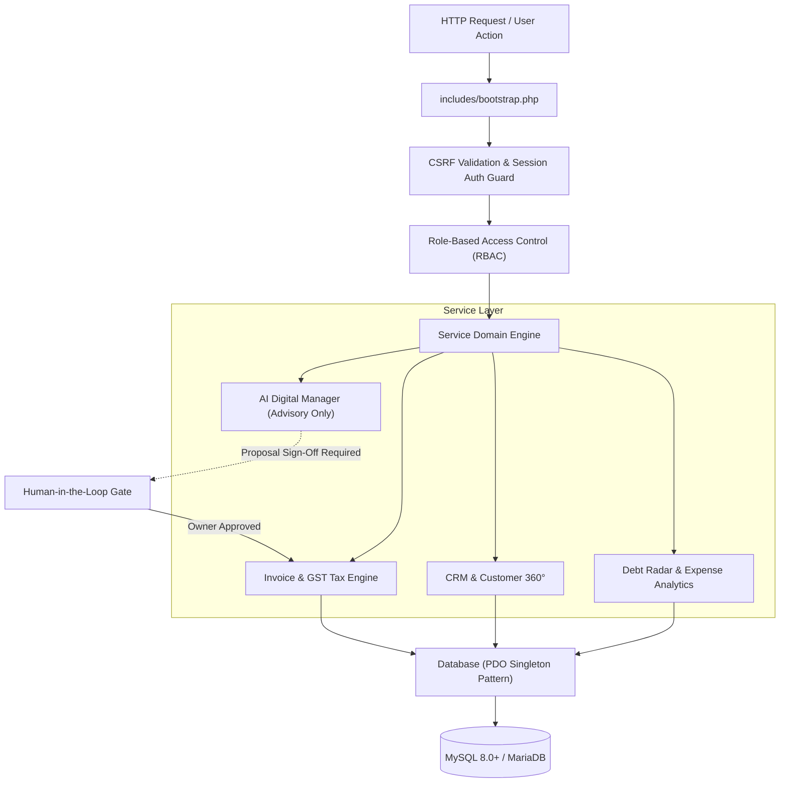
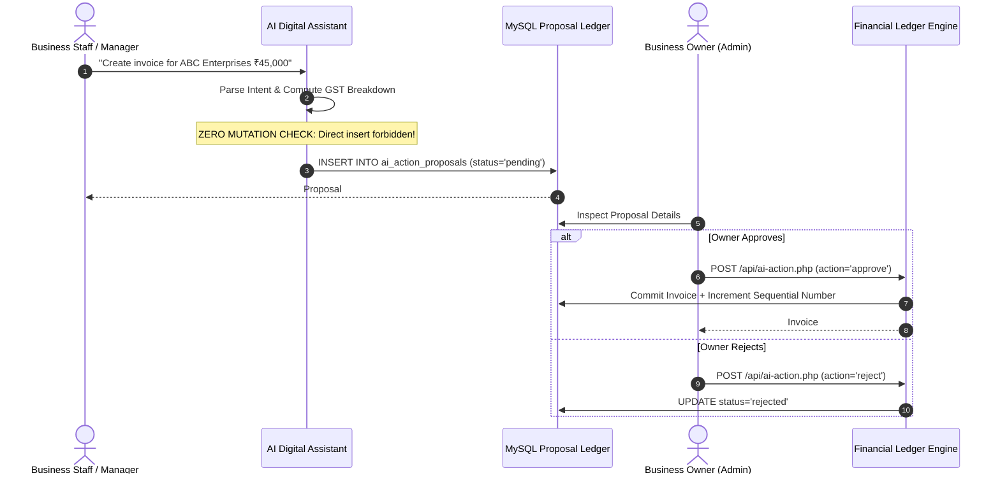
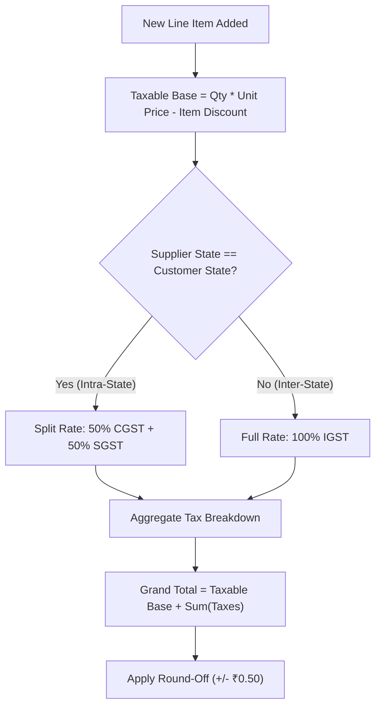
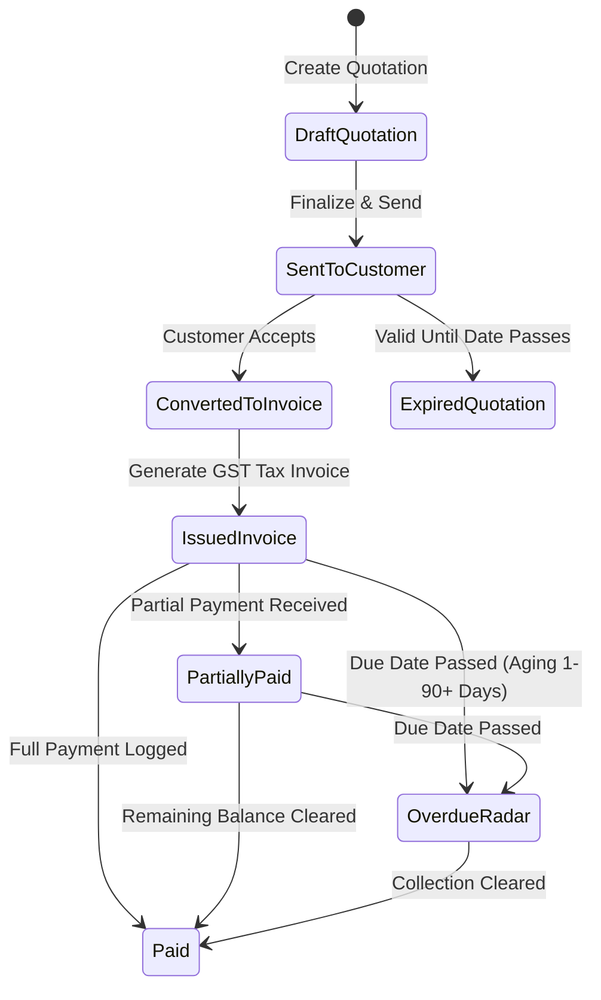
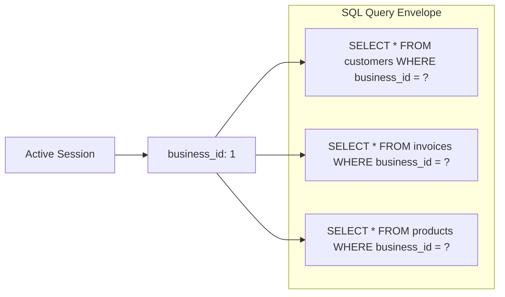
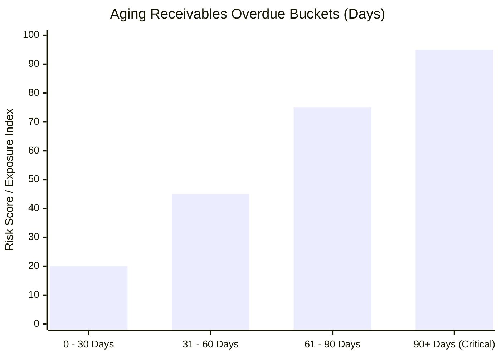

# ⚙️ YBT Management Software — System Logic & Domain Architecture

> **Enterprise Technical Specification & Algorithmic Blueprint**  
> Maintained by **Pranav Sahu** • [Aronar AI](http://aronar-ai.vercel.app/) • [Hexatom](https://hexatom-org.vercel.app/)

---

## 📑 Table of Contents
1. [Core Architectural Principles](#-core-architectural-principles)
2. [Zero Direct Mutation AI Safety Invariant](#-zero-direct-mutation-ai-safety-invariant)
3. [GST Financial Calculation Engine](#-gst-financial-calculation-engine)
4. [Commercial Lifecycle State Machine](#-commercial-lifecycle-state-machine)
5. [Multi-Tenant Data Isolation Matrix](#-multi-tenant-data-isolation-matrix)
6. [Debt Radar & Aging Receivables Algorithm](#-debt-radar--aging-receivables-algorithm)
7. [Security & Audit Integrity](#-security--audit-integrity)

---

## 🏛️ Core Architectural Principles

YBT Management Software is designed around strict deterministic financial and operational invariants.

---

## 🤖 Zero Direct Mutation AI Safety Invariant

The AI Digital Operations Manager functions strictly as an **advisory intelligence layer**. Under no circumstances can AI agents or LLM function calls mutate financial databases directly.

### The Safety Protocol:
1. **Advisory Formulation**: AI generates structured suggestions (`ai_action_proposals`).
2. **Deterministic Cryptographic Key Management**: External API keys (Google Gemini, OpenRouter, OpenAI, Anthropic) are encrypted at rest with **AES-256-CBC**.
3. **Owner Approval Boundary**: Invoices, expense logs, and credit line updates stay in `pending_approval` until an authorized Owner provides signature.

---

## 🧾 GST Financial Calculation Engine

The system supports automated intra-state vs inter-state tax routing according to the Indian Goods and Services Tax (GST) Act:

### 1. Place of Supply (PoS) Determination:
$$\text{Supply Type} = \begin{cases} 
\text{Intra-State (CGST + SGST)}, & \text{if } \text{State}_{\text{Supplier}} = \text{State}_{\text{Customer}} \\ 
\text{Inter-State (IGST)}, & \text{if } \text{State}_{\text{Supplier}} \neq \text{State}_{\text{Customer}} 
\end{cases}$$

### 2. Tax Computation Formulae:
- **Intra-State:**
  $$\text{CGST} = \text{Taxable Base} \times \frac{\text{GST Rate}}{2}$$
  $$\text{SGST} = \text{Taxable Base} \times \frac{\text{GST Rate}}{2}$$
- **Inter-State:**
  $$\text{IGST} = \text{Taxable Base} \times \text{GST Rate}$$
- **Final Document Total:**
  $$\text{Gross Total} = \sum (\text{Line Subtotal}) - \text{Discount} + \text{Taxes} + \text{Round Off}$$

---

## 🔄 Commercial Lifecycle State Machine

Quotations, Tax Invoices, and Payments follow an immutable forward-only transition model.

---

## 🛡️ Multi-Tenant Data Isolation Matrix

Data security enforces multi-tenant boundary integrity through strict SQL predicate binding:

- Every mutating query verifies `business_id = $_SESSION['business_id']`.
- Role-based permissions (`permissions.php`) validate capability keys before rendering views or accepting payloads.
- Password hashes use native `BCRYPT` with dynamic work factor cost.

---

## 📊 Debt Radar & Aging Receivables Algorithm

The financial telemetry module buckets overdue receivables dynamically using epoch day differences:

$$\text{Days Overdue} = \max\left(0, \frac{\text{Current Date} - \text{Invoice Due Date}}{86400}\right)$$

- **Current (0-30 Days)**: Normal operating collection window.
- **Moderate (31-60 Days)**: Automated follow-up notice proposal.
- **Severe (61-90 Days)**: Credit limit freeze on customer profile.
- **Critical (90+ Days)**: Bad-debt alert flagged to Executive Owner.

---

## 👨‍💻 Developer & Engineering Attribution

### **Co. Pranav Raj Sahu**
#### **Hexatom Team &bull; Aronar AI**

- **Lead Architect**: Co. Pranav Raj Sahu
- **AI Research & Platform**: [Aronar AI](http://aronar-ai.vercel.app/)
- **Core Engineering Lab**: [Hexatom](https://hexatom-org.vercel.app/)
- **Hexatom Portfolio**: [hexatom.imaginefuture1-7.workers.dev](https://hexatom.imaginefuture1-7.workers.dev/)
- **Pranav Sahu Portfolio**: [pranav005-portfolio.netlify.app](https://pranav005-portfolio.netlify.app/)
- **Wear Tome**: [weartome.com](https://weartome.com)
- **Direct Contact**: +91 8103244491
- **Email Inquiries**: [hexatom.dev@gmail.com](mailto:hexatom.dev@gmail.com) • [pranavsahu005@gmail.com](mailto:pranavsahu005@gmail.com) • [aronararonarbrand@gmail.com](mailto:aronararonarbrand@gmail.com)
- **Repository**: [github.com/pranavsahu005/ybt-management-software](https://github.com/pranavsahu005/ybt-management-software)
