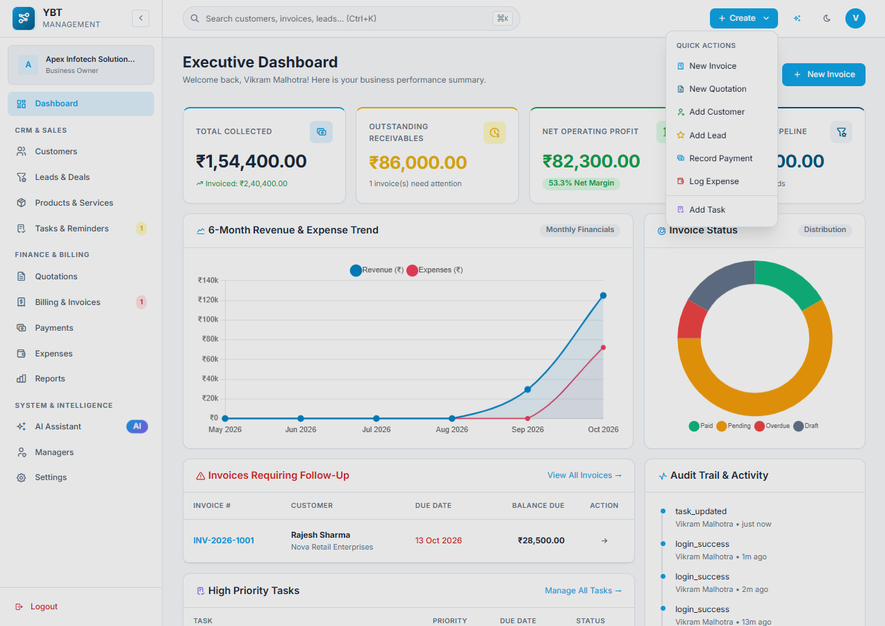
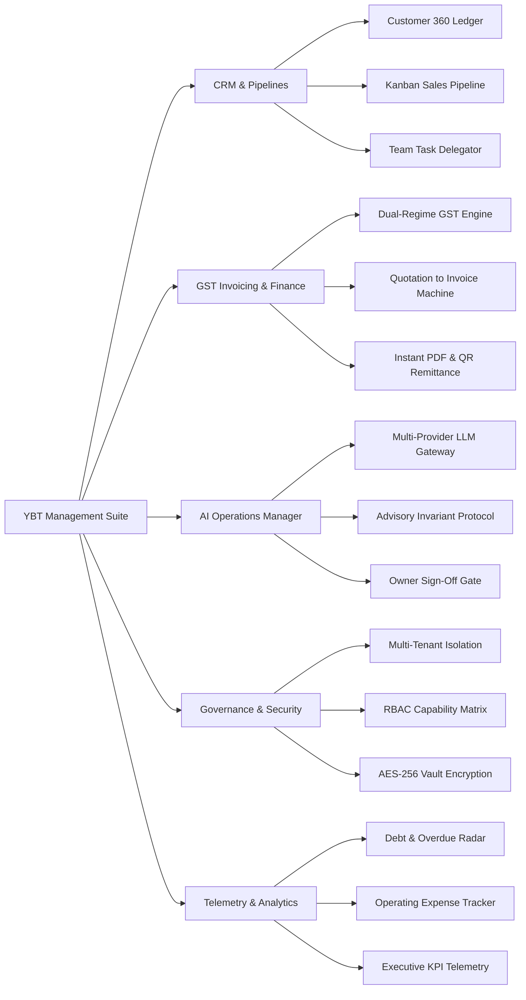
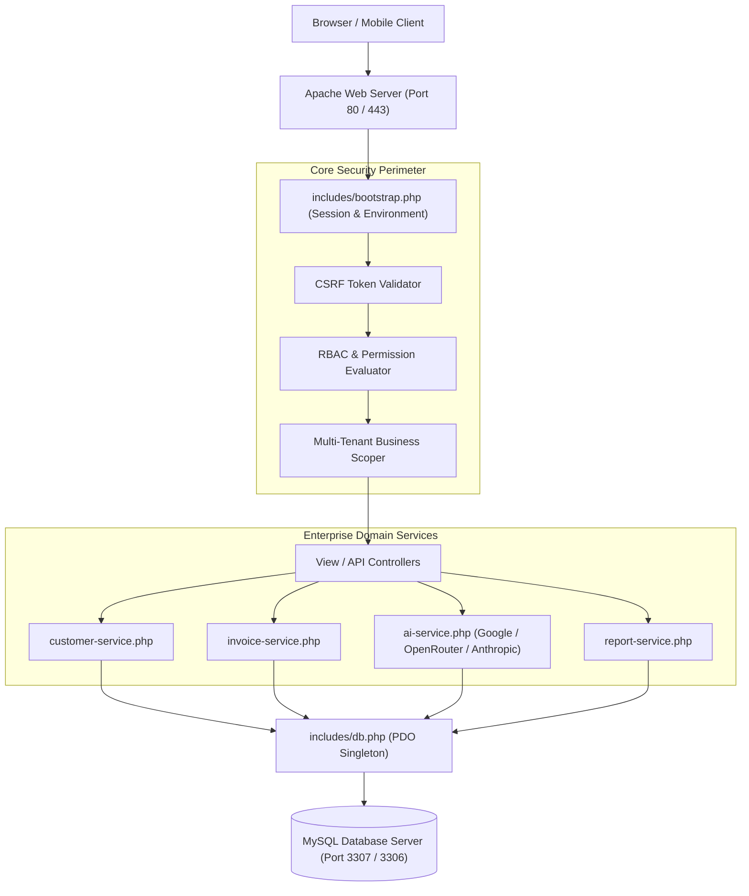
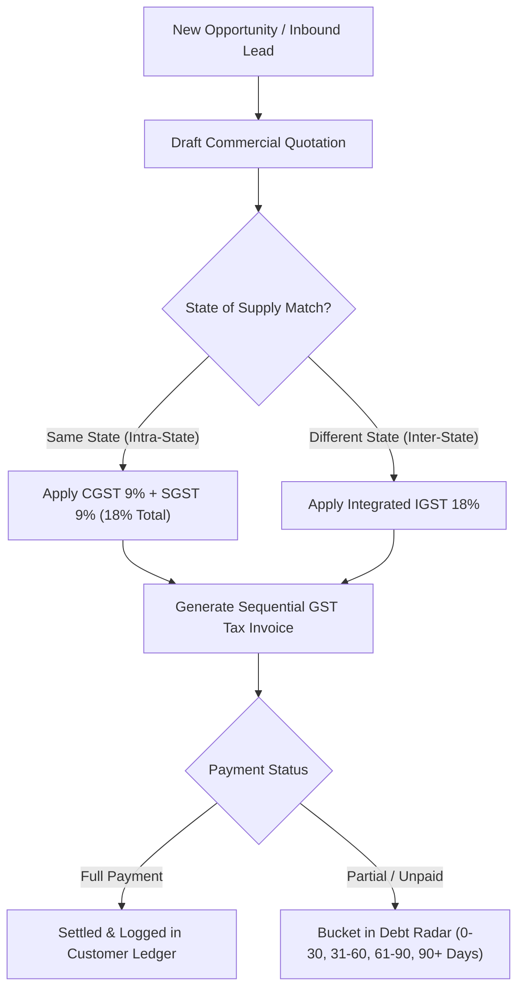
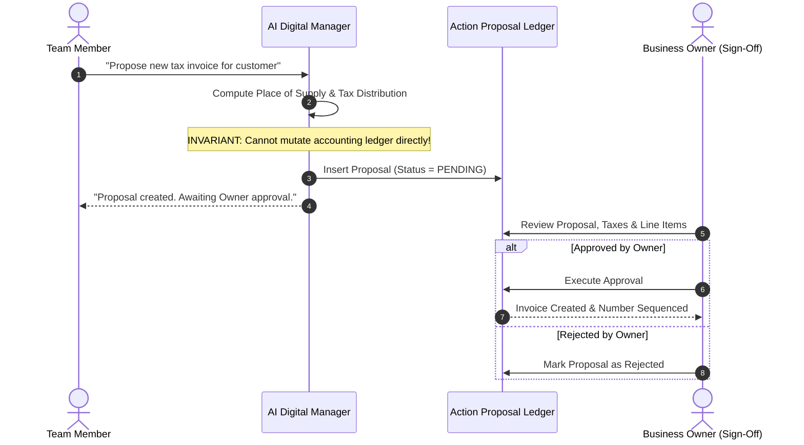

# ⚡ YBT Management Software (Enterprise Edition)

<p align="center">
  
</p>

<p align="center">
  <b>Enterprise-Grade Business Management, GST Invoicing Engine & Advisory AI Digital Manager</b>
</p>

<p align="center">
  <a href="YBT_Management_Software_PRD.md"></a>
  <a href="LOGIC.md"></a>
  <a href="https://php.net"></a>
  <a href="https://mariadb.org"></a>
  <a href="#"></a>
</p>

---

## 👨‍💻 Engineering & Developer Ecosystem

<table align="center" width="100%">
  <tr>
    <td align="center" width="33%">
      <b>Lead Architect</b><br>
      <b>Pranav Sahu</b><br>
      <sub>System Design & Engineering</sub>
    </td>
    <td align="center" width="33%">
      <b>AI Innovation Lab</b><br>
      <a href="http://aronar-ai.vercel.app/"><b>Aronar AI</b></a><br>
      <sub>Next-Gen Cognitive Intelligence Platform</sub>
    </td>
    <td align="center" width="33%">
      <b>Core Software Lab</b><br>
      <a href="https://hexatom-org.vercel.app/"><b>Hexatom</b></a><br>
      <sub>Enterprise Technology & Systems</sub>
    </td>
  </tr>
</table>

---

**YBT Management Software** is a full-stack, enterprise-grade business management and ERP system designed for Indian trade, distribution, and service enterprises. Built from the ground up according to the comprehensive specification in [YBT_Management_Software_PRD.md](YBT_Management_Software_PRD.md) and technical invariants in [LOGIC.md](LOGIC.md).

---

## 🗺️ System Topology & Enterprise Mindmap



---

## 🏗️ Enterprise System Architecture Blueprint



---

## 🌟 Core Highlights & Capabilities

### 1. 🤖 AI Digital Operations Manager
- **Zero Direct Mutation Safety Invariant:** The AI is strictly advisory and cannot modify ledgers directly. Action proposals (e.g. creating invoices, logging expenses) require manual Owner sign-off.
- **Multi-Provider Cloud LLM Engine:**
  - **Google AI Studio (Gemini):** Native support for `gemini-1.5-flash`, `gemini-1.5-pro`, `gemini-2.0-flash-exp`.
  - **OpenRouter (Unified API):** Access to `google/gemini-flash-1.5`, `anthropic/claude-3.5-sonnet`, `deepseek/deepseek-chat`, `openai/gpt-4o-mini`.
  - **OpenAI & Anthropic:** Direct vendor integration.
  - **Custom / Local AI:** Support for local Ollama, LM Studio, Groq, and vLLM reverse proxies.
- **AES-256-CBC Encryption at Rest:** All external API keys are stored in encrypted format in MySQL.
- **Autonomous Local Fallback:** Automatically switches to the built-in intelligent rule engine if external APIs are unreachable or offline.

### 2. 🧾 GST Invoicing & Quotation Engine
- **State Tax Compliance:** Automated intra-state (CGST + SGST) vs inter-state (IGST) calculations based on Place of Supply.
- **One-Click Conversions:** Seamlessly convert quotations into verified invoices with automatic sequential numbering.
- **Instant PDF Generation:** Clean, printable, GST-compliant tax invoices with QR/UPI codes and bank remittance details.

### 3. 👥 Comprehensive CRM & Pipeline Management
- **Customer 360° Ledger:** Real-time receivables, transaction logs, credit limits, and contact profiles.
- **Kanban Lead Pipeline:** Visual drag-and-drop opportunity pipeline (New, Contacted, Qualified, Proposal, Won, Lost).
- **Task Scheduling & Assignments:** Team task delegation with priorities and deadlines.

### 4. 📊 Financial Intelligence & Debt Radar
- **Aging Receivables Radar:** Proactive aging analysis (0-30, 31-60, 61-90, 90+ days overdue).
- **Operating Expense Tracking:** Category-wise expenditure analysis with profit and margin calculations.
- **Executive Reports:** Revenue vs expenses, top revenue customers, tax liabilities, and sales velocity metrics.

### 5. 🛡️ Role-Based Access Control (RBAC) & Enterprise Security
- Strict multi-tenant data isolation by `business_id`.
- Granular permission matrix (`ai.financial`, `invoices.create`, `settings.edit`, etc.).
- CSRF protection across all forms, session timeout management, and rate-limited brute-force lockout defenses.
- Curated high-contrast **Light and Dark Mode** theme switcher with persistent local storage.

---

## 🔄 Commercial Financial Flow & Tax Routing



---

## 🤖 AI Digital Manager Protocol (Human-in-the-Loop)



---

## 💻 Technology Stack & Architectural Matrix

| Layer | Technology | Version | Purpose in Architecture |
| :--- | :--- | :--- | :--- |
| **Backend Runtime** | **PHP** | `8.2.12+` | High-performance core execution, strict typing, session isolation |
| **Relational Database**| **MySQL / MariaDB** | `8.0+ / Port 3307` | Relational integrity, foreign keys, transaction rollbacks |
| **Database Access** | **PDO Singleton** | `Native` | Prepared statements, zero SQL injection risk |
| **Cryptography** | **OpenSSL (AES-256-CBC)**| `Native` | At-rest encryption for LLM API keys and secrets |
| **Data Visualization**| **Chart.js** | `4.4.1 UMD` | KPI telemetries, revenue vs expenses, aging radar graphs |
| **Interface Icons** | **Tabler Icons** | `v2.40.0` | Crisp SVG and webfont iconography across dark/light themes |
| **Frontend Styling** | **Modern Vanilla CSS**| `CSS3 Vars` | Fluid grid, responsive flexbox, light/dark mode engine |

---

## 🚀 Quick Setup & Installation

### Requirements
- **Web Server:** Apache (via XAMPP, WampServer, or standalone)
- **PHP:** Version 8.1 or higher (with `pdo_mysql`, `curl`, `openssl`, `mbstring` extensions)
- **Database:** MySQL 5.7+ or MariaDB 10.4+

### Setup Steps
1. **Clone the Repository:**
   ```bash
   git clone https://github.com/YouBTech01/ybt-management-software.git
   ```
2. **Move to Web Root:**
   Move or place the directory into your server's root (e.g. `C:\xampp\htdocs\YBT Management Software`).
3. **Database Setup:**
   - Create a MySQL database named `ybt_management`:
     ```sql
     CREATE DATABASE ybt_management CHARACTER SET utf8mb4 COLLATE utf8mb4_unicode_ci;
     ```
   - Run the database migration and seeder:
     ```bash
     php database/seed.php
     ```
4. **Configuration:**
   - Verify settings in `config/config.php` (DB credentials, encryption key, session settings).
5. **Launch Application:**
   - Open your browser at: `http://localhost/YBT%20Management%20Software`

---

## 👤 Default Demo Credentials

| Role | Name | Email | Password | Access Level |
| :--- | :--- | :--- | :--- | :--- |
| **Business Owner** | Vikram Malhotra | `owner@ybt.com` | `password123` | Full Super-Admin & Financial Controls |
| **Operations Manager** | Rohan Verma | `manager@ybt.com` | `password123` | CRM, Pipeline, Invoicing & AI Operations |

---

## 📁 Project Architecture

```
YBT Management Software/
├── YBT_Management_Software_PRD.md   # Official Product Requirements Document
├── index.php                        # Root router
├── login.php                        # Clean, modern authentication portal
├── dashboard.php                    # KPI telemetry, charts & overdue radar
├── customers.php                    # Customer directory & balances
├── customer-view.php                # Customer ledger & profile 360°
├── leads.php                        # Sales opportunity Kanban pipeline
├── quotations.php                   # Quotation management
├── quotation-create.php             # Dynamic quotation builder
├── invoices.php                     # GST invoice directory
├── invoice-create.php               # Invoice creation with auto-tax computation
├── invoice-view.php                 # Invoice preview & PDF generation
├── payments.php                     # Payment recording & reconciliation
├── expenses.php                     # Operating expense management
├── reports.php                      # Financial analytics & export center
├── ai-assistant.php                 # AI Digital Manager interface
├── managers.php                     # Team & employee management
├── settings.php                     # Business, Tax, Backup & AI Provider API setup
├── api/
│   ├── ai.php                       # AI natural language chat endpoint
│   └── ai-test-provider.php         # Real-time AI API latency probe
├── services/
│   ├── ai-service.php               # AI Orchestrator & fallback engine
│   ├── ai-provider-service.php      # Google Gemini / OpenRouter / OpenAI client
│   ├── ai-tools.php                 # Sandboxed read-only business data query tools
│   ├── ai-memory-service.php        # Conversation context persistence
│   ├── invoice-service.php          # Invoice numbering & calculations
│   ├── pdf-service.php              # Server-side PDF invoice generation
│   ├── backup-service.php           # Database dump & export utility
│   └── restore-service.php          # Emergency ledger restoration
├── includes/
│   ├── bootstrap.php                # Core initializer & autoloader
│   ├── db.php                       # Secure PDO database singleton
│   ├── auth.php                     # Authentication & session controls
│   ├── permissions.php              # Granular RBAC permission manager
│   ├── csrf.php                     # Cryptographic CSRF validation
│   ├── header.php / footer.php      # Base layouts
│   └── sidebar.php / topbar.php     # Navigation components
├── assets/
│   ├── css/                         # Global design system, components, dark mode
│   └── js/                          # Tabler charts, table filtering, theme engine
└── docs/
    ├── ai-configuration.md          # Multi-provider AI setup guide
    └── user-manual.md               # User operational manual
```

---

## 📄 Documentation & Links
- [Product Requirements Document (PRD)](YBT_Management_Software_PRD.md)
- [AI Provider Configuration Guide](docs/ai-configuration.md)
- [User Operational Manual](docs/user-manual.md)

---
&copy; 2026 **YOU B TECH** &bull; All Rights Reserved.
